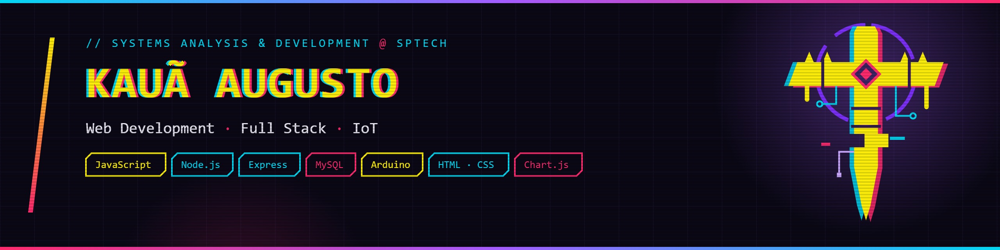

### Hi, I'm Kauã 👋

**Systems Analysis and Development** student at **SPTech** and **Electronics Technician** from **ETEC Jorge Street**. 
I build projects that bring **hardware and software** together: from the sensor on an Arduino to the dashboard in the browser.

---

### `> whoami`

- 🎓 **Systems Analysis and Development** at SPTech (São Paulo Tech School), 2026 – 2028
- ⚡ **Electronics Technician**, ETEC Jorge Street (2025): analog and digital circuits, instrumentation and microcontrollers
- 🌐 **Full stack web development**: HTML, CSS and JavaScript on the front end, REST APIs with Node.js + Express, MySQL databases
- 🔌 **Embedded systems with Arduino (C/C++)**: sensor data acquisition, serial communication and integration with APIs and databases
- 📍 Santo André, SP, Brazil

### `> stack --list`

### `> ls ./projects`

<table>
<tr>
<td width="50%" valign="top">

#### ⚡ [Edgerunning](https://github.com/kaua-augusto/Projeto-Individual)
**Individual project · SPTech**

A Cyberpunk 2077 completion tracker: players record achievements, missions and hours played, and the dashboard calculates completion percentage, what is left to reach 100% and monthly progress.

- REST API with **Node.js + Express** following a routes → controllers → models structure
- **MySQL** database with views and an idempotent setup script
- Charts with **Chart.js**, sign-up/login and a serverless demo mode

`JavaScript` `Node.js` `Express` `MySQL` `Chart.js`

</td>
<td width="50%" valign="top">

#### 🧀 [Blue Cheese Solutions](https://github.com/1S-Blue-Cheese-Solutions/monitoramento-de-temperatura-e-umidade-do-ar)
**Team project · SPTech**

IoT monitoring of air temperature and humidity in blue cheese ripening chambers, from the sensor to the dashboard.

- **Arduino UNO + DHT11 sensor** streaming readings over serial
- **Node.js** API (serialport) storing measurements in **MySQL**
- Company website with login, location management and real-time dashboards

`Arduino` `C++` `Node.js` `MySQL` `HTML/CSS/JS`

</td>
</tr>
</table>

`> status: online_` · always learning something new

